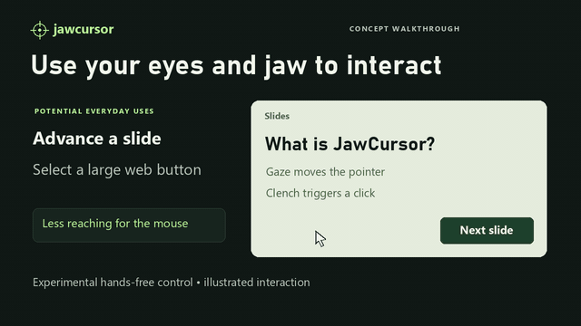

# jawcursor

**Look to aim. Clench to click.** JawCursor is an experimental hands-free pointer.
The design uses a webcam to estimate gaze and AirPods motion to detect jaw
clenches for clicks.

## Demo

[](docs/media/jawcursor-trailer.mp4)

[Full 42-second tutorial (MP4)](docs/media/jawcursor-trailer.mp4)

The narrated tutorial shows a Windows PC using its webcam for gaze estimation,
with an iPhone or Mac relaying compatible AirPods motion. It covers potential
uses, staged setup, and a verified dry run with three clicks from simulated motion.
Real AirPods clench detection and real-person gaze accuracy still need testing.

[Try the dry run without AirPods](#try-without-airpods) or [connect compatible AirPods](#connect-the-airpods) and run `jawcursor monitor` to help test.

**Give JawCursor a star on GitHub.** It takes one click to support the project
and help more people discover hands-free computing.

```
webcam  --> face landmarks --> gaze estimate --> smoothing --> cursor position
AirPods --> relay app --> motion samples --> clench detector --> click
```

## Status: read this first

Built and tested on Windows 11 without AirPods or a face in front of the camera,
so some parts are proven and some are not.

| Part | State |
| --- | --- |
| Clench detector, click logic, cursor control, calibration maths | 66 automated tests pass |
| Receiving motion over the network, record, replay, monitor, dry run | Run end to end here with simulated motion |
| Face and iris tracking (MediaPipe 1.2.3, OpenCV 5.0, Python 3.12) | Run on a sample portrait photo; webcam loop runs at 30 fps |
| Gaze accuracy on a real person | Not measured. The calibration reports it for you |
| Clench detection on real AirPods data | Not measured. The simulated clench is a guess at the signal shape |
| JawBridge (Swift) | Written against Apple's documented API, never compiled |
| Sensor Logger input | Parser follows the app's published format, never run against the app |
| macOS | Python side not run there |

The honest unknown is how clearly your clench shows up in AirPods motion data,
which arrives at roughly 25 samples a second. `jawcursor monitor` shows that in
the first minute, before you invest in anything else.

## What you need

- AirPods that support head tracking: AirPods Pro, AirPods Max, AirPods 3rd
  generation or later, or Beats Fit Pro.
- An Apple device to relay their motion. Apple only exposes it through
  CoreMotion (`CMHeadphoneMotionManager`, iOS 14+ and macOS 14+), so Windows
  and Linux cannot read it directly. The AirPods connect to the relay device,
  not to the PC.
- A webcam at about eye level, with even light on your face.
- Python 3.10 to 3.12.

Two layouts work:

- **Mac only.** jawcursor and JawBridge both run on the Mac.
- **Windows or Linux laptop plus an iPhone.** The iPhone relays over Wi-Fi.

## Install

```
cd jawcursor
uv venv --python 3.12 .venv
uv pip install --python .venv/Scripts/python.exe -e ".[dev]"     # Windows
uv pip install --python .venv/bin/python -e ".[dev]"             # macOS, Linux
```

Plain `python -m venv .venv` and `pip install -e ".[dev]"` work too. The
commands below assume the environment is active, or prefix them with
`.venv/Scripts/` (Windows) or `.venv/bin/`.

```
jawcursor doctor
```

checks the camera, the screen, and whether motion data is arriving. The face
model (3.7 MB) downloads to `~/.jawcursor` on first use.

## Connect the AirPods

Start `jawcursor monitor` on the laptop. It prints the address to send to, for
example `192.168.1.20:7355`. On Windows, allow Python through the firewall on
private networks when asked.

### Option A: JawBridge (needs a Mac with Xcode)

A three-file SwiftUI app in `apple/JawBridge` that runs on an iPhone or on the
Mac itself and sends each motion sample as a UDP packet.

1. Xcode, File, New, Project, Multiplatform, App. Name it `JawBridge`.
2. Delete the generated `ContentView.swift` and `JawBridgeApp.swift`, then drag
   in the three files from `apple/JawBridge` (tick "Copy items if needed").
3. Target, General, Minimum Deployments: iOS 16.0, macOS 14.0.
4. Target, Info, add two keys:
   - Privacy - Motion Usage Description: `Reads AirPods motion to detect jaw clenches.`
   - Privacy - Local Network Usage Description: `Sends motion data to jawcursor on your laptop.`
5. Target, Signing & Capabilities: pick your team (a free personal team is
   enough). For the Mac build, tick App Sandbox, Outgoing Connections (Client),
   or remove App Sandbox.
6. Run it on the iPhone or on "My Mac". Put the AirPods in, connected to that
   device. Enter the laptop's address (`127.0.0.1` if it is the same Mac) and
   port `7355`, press Start streaming, and allow the two permission prompts.

On an iPhone, keep the app in the foreground; it keeps the screen awake.

If Xcode reports Swift concurrency errors, set Build Settings, Swift Language
Version to Swift 5.

### Option B: Sensor Logger (no Xcode)

The free Sensor Logger app on the App Store can record AirPods motion and push
it over HTTP.

1. Enable the Headphone Motion sensor.
2. In its settings, turn on HTTP Push and set the push URL to
   `http://<laptop address>:7355/data`. "Tap to Test Pushing" checks the link.
3. Set the batch period as short as it allows, then start recording.

It sends samples in batches, so clicks arrive one batch late. They still land
where you were looking when you clenched, because every sample carries its own
timestamp.

## First run

Do these in order. Each one tells you whether the next is worth doing.

```
jawcursor monitor              # 1. is the clench visible?
jawcursor calibrate clench     # 2. one minute, guided, fits thresholds to you
jawcursor run --no-gaze        # 3. clench to click, steering with your normal mouse
jawcursor calibrate gaze       # 4. follow 13 dots, about 30 seconds
jawcursor run                  # 5. eyes move the cursor, jaw clicks
```

1. **Monitor.** Sit still and bite down quickly and firmly on your back teeth,
   then let go. The score bar should jump well above the threshold and print
   `CLENCH`. Turn your head, nod and talk: it should stay quiet. If clenches
   barely register, reseat the AirPods snugly or try larger ear tips.
2. **Clench calibration** records rest, normal movement and ten cued clenches,
   then picks the threshold and the sensor channels that separate them best. It
   tells you how many clenches it caught and how many false triggers it saw,
   and refuses to save a result that is not reliable.
3. **`--no-gaze`** is the quickest useful mode and isolates clicking from
   pointing.
4. **Gaze calibration** ends with an accuracy figure measured on dots that were
   left out of the fit, so it is not flattering itself. Under about 3.5 percent
   of screen width is good. Above 7 percent, fix the lighting and camera
   position and repeat. Recalibrate whenever you move the laptop or your seat.
5. **Run.** Add `--preview` to see what the camera sees, `--dry-run` to print
   clicks without touching the real cursor.

## Controls

| | |
| --- | --- |
| One clench | Left click, placed where the cursor was just before the clench |
| Two quick clenches | Double click. With `--right-click`: right click |
| Ctrl+Alt+P | Pause and resume |
| Ctrl+Alt+Q | Quit |
| Move the real mouse | Takes over for two seconds |
| Blink | Cursor holds still |

With `--right-click`, a single click waits 0.6 s to see whether a second clench
follows.

## How the clench detector works

Clenching bulges the jaw muscles beside the ear canal and nudges the earbud: a
short burst of rotation and acceleration. Head movement is larger and slower.

1. A running average tracks the slow part of the signal (head motion) and is
   subtracted, leaving the fast part.
2. The fast part is compared with a running noise floor, so thresholds are
   multiples of your own resting noise and do not depend on units.
3. A burst counts as a clench only if the head was otherwise still, the burst
   was short, and the earbud ended up pointing almost where it began.
4. A held clench produces a second burst on release that points the opposite
   way. That one is recognised and ignored.

The click is issued when the burst ends, at the cursor position from just
before it began, and the cursor is held for a moment afterwards, because
clenching also disturbs the gaze estimate.

It cannot tell chewing from clenching. Pause it when you eat.

## Tuning

Settings live in `~/.jawcursor/config.json` (written by `calibrate clench`;
`jawcursor/config.py` lists every field and its default).

| Symptom | Change |
| --- | --- |
| Stray clicks when talking or moving | Raise `clench.k_on`, lower `clench.max_head_rate` |
| Clenches missed | Lower `clench.k_on`, or recalibrate with a sharper bite |
| Cursor jitters on a target | Lower `pointer.min_cutoff`, raise `pointer.deadzone` |
| Cursor lags behind the eyes | Raise `pointer.beta` or `pointer.min_cutoff` |
| Click lands after the cursor was dragged | Raise `pointer.click_lead` |

To study your own signal:

```
jawcursor record clenches.csv --seconds 30
jawcursor replay clenches.csv
```

## Try without AirPods

Run these in separate terminals to send synthetic motion and see dry-run click
events. The dry run leaves the system cursor untouched.

```
jawcursor run --dry-run --no-gaze --host 127.0.0.1      # terminal 1
jawcursor simulate --clench-every 3                      # terminal 2
```

## Limits

- Webcam gaze is coarse, typically a few centimetres on screen. Large targets
  and zoomed pages work; small toolbar buttons are hard.
- Only the primary screen is used.
- On Windows it cannot click inside windows running as administrator unless
  jawcursor is also run as administrator.
- On macOS, grant the terminal Camera, Accessibility and Input Monitoring.
- AirPods audio plays from the relay device while it holds the connection.

## Troubleshooting

| Problem | Likely cause |
| --- | --- |
| `camera image: all black` | Privacy shutter or lens cover is closed |
| `AirPods: no data` | Wrong address in the relay app, firewall, or phone and laptop on different networks |
| JawBridge says motion is unavailable | AirPods model without head tracking, or not connected to that device |
| `Port 7355 is not available` | Something else has it. Use `--port` on both sides |
| Camera takes long to open on Windows | Normal for a few seconds. The code already prefers the faster backend |

## Layout

```
jawcursor/
  clench.py      detector, click gestures, threshold fitting
  imu.py         packet formats, clock mapping, UDP and HTTP receiver
  gaze.py        camera, MediaPipe face tracking, gaze features
  mapping.py     features to screen position, cross-validated ridge regression
  pointer.py     smoothing, cursor leash, click placement, mouse takeover
  calibrate.py   gaze dots screen, guided clench recording
  app.py         the run loop
  simulate.py    made-up motion for testing
  cli.py         commands
apple/JawBridge/ SwiftUI relay app (three files)
tests/           pytest suite
```

Run the tests with `python -m pytest`.
